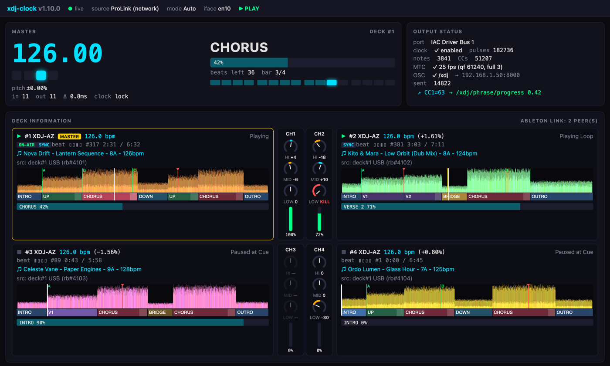

# xdj-midi

[](Cargo.toml)





---

### Bridge between Pioneer CDJ/XDJ hardware (Pro DJ Link), Ableton Link and MIDI clock, MTC, CC, and note output.


## ✨ Features

### Pro DJ Link (Ethernet)
- Joins the ProLink network as a Virtual CDJ (device #7 by default).
- Supports CDJ-3000 and XDJ-AZ absolute-position packets and metadata.
- Gets the waveform preview, the beat grid and the phrases of each loaded rekordbox track from the player.
- Gets the hot cues, the memory cues and the saved loops of the track.
- Tracks tempo master with explicit master flags and playing-state fallback.

### Ableton Link
- Auto mode prefers Link peers when present and falls back to Pro DJ Link.
- Default polling is 500µs for tight MIDI clock synchronization.
- Peer count and tempo are visible in the web UI and logs.

### MIDI Output
- Stable MIDI Clock (0xF8) pulses with Start/Stop/Continue support.
- Remappable CCs for BPM, pitch, bar phase, beat phase, playing state, master deck, and phrase-16.
- MIDI notes on every beat and on each downbeat.
- Phrase kind of the master deck as CC 20 (kind code times 10), as notes 40–51 and as Program Change (off by default). CC 21 sends the phrase progress. CC 22 sends the beats left in the phrase.

### OSC Output
- OSC over UDP to a lighting desk or a media server, for example grandMA3, ChamSys MagicQ, Avolites Titan, Resolume or TouchDesigner.
- The messages send the beat, the BPM as a float, the phrase name, the NO_BASS state and the track title.

---

## 🚀 Quick Start

### Download the release
1. download the latest release on the right
2. run it.

### Web UI
The app serves a dashboard in the browser at port 11111. The start-up log shows the address for each network interface, for example `http://192.168.1.20:11111`.
- The data comes over a WebSocket, about 30 times per second. Each beat comes at the moment it arrives.
- You can change all settings and select the MIDI output port in the dashboard.

The dashboard has these panels:

| Panel | What it shows |
|---|---|
| Master | The master BPM, the beat in the bar, the pitch, the phrase of the master deck and its 16-beat position, and the clock state. |
| Output Status | The MIDI port, the clock pulses, the notes and the CCs, the MTC state, and the OSC targets with the message count, the errors and the last message. |
| Deck Information | One card for each player, two cards in one row. See below. |
| Settings | All settings and the MIDI output port. Each setting has a tooltip. Each note and CC has an on/off switch (✓ or ✗). |
| Logs | The latest log lines. |

Each deck card shows the play state, the BPM, the pitch, the beat, the playhead time and the track. When the track has rekordbox analysis data, the card also shows:
- The colour waveform of the full track.
- A white line at the playhead.
- A yellow band on the active loop. The XDJ-AZ loop position is not confirmed yet.
- Orange bands on the saved loops and red marks on the memory cues.
- Green marks with a letter (A to H) on the hot cues.
- A lane under the waveform with the phrases of the track (for example INTRO, VERSE, CHORUS, OUTRO). The phrase under the playhead is brighter. A light part at the end of a phrase is the fill-in.

When the XDJ-AZ mixer sends data, the mixer channels are between the two decks of each row. Channel n is next to player n. Each channel shows HI, MID and LOW as knobs and the fader as a bar. A knob turns left for a cut and right for a boost. KILL shows a full cut. A grey control did not move since the app started.

The page gets the waveform, the cues and the phrases of a deck from `GET /waveform/{deck}`, one time for each track.
- When port 11111 is in use, the app uses the next free port, up to 11130.
- Use `--web-bind 127.0.0.1:11111` or `[web] bind` in `config.toml` to change the address.

**Warning:** The dashboard has no login. By default, it listens on all interfaces. Anyone on the same network can change the MIDI settings. To allow access from this computer only, use `--web-bind 127.0.0.1:11111`.

### Raspberry Pi and unattended use
The `xdj-clock-linux-aarch64` release runs on a Raspberry Pi 3, 4 or 5 with a 64-bit OS.

The app recovers from these faults without a restart:
- When the MIDI device goes away, the app tries to open the same port again every 2 s. When the port comes back, the clock sends Stop, then Start on the next phrase. MTC sends a full frame.
- When the network is not up at start, the app waits for it.
- When the IP address goes away, the app finds the network again within a few seconds. Then it joins the Pro DJ Link network again.
- When you change the interface in the web UI, the app uses the new interface within 2 s.

To run the app as a service:
1. Copy `xdj-clock` and `config.toml` to `/opt/xdj-clock/`.
2. Copy `xdj-clock.service` to `/etc/systemd/system/`.
3. Run `sudo systemctl daemon-reload`.
4. Run `sudo systemctl enable --now xdj-clock`.
5. Read the log with `journalctl -u xdj-clock -f`.

The service runs the app with real-time priority. Open the web UI from another computer at `http://<pi-address>:11111`. `systemctl stop` sends MIDI Stop before the app exits.

Before a long night, test the MIDI path on the target machine:
```sh
./xdj-clock --soak midi-clock --duration-secs 36000 --report soak.json
```
The test passes when the p99 jitter is 5 ms or less and no messages drop.

**Note:** Keep the log level at `info`. The `trace` level writes every packet, which is approximately 1 GB in 10 hours.

---

## ⚙️ Configuration

Settings are managed via `config.toml` for the host and `sdkconfig` for the ESP32. You should be able to just run the app without any changes to these just fine.

```toml
# config.toml defaults
source = "auto"       # "auto" | "link" | "prolink"
device_number = 7      # Virtual CDJ ID
interface = "auto"    # Network adapter selection
device_name = "xdj-clock"

[midi]
output = "auto"       # MIDI port substring match
clock_enabled = true
clock_loop_enabled = true
smoothing_ms = 0       # BPM jitter reduction
latency_compensation_ms = 0
# Bar interval for phrase-lock full resync (1 bar = 4 beats).
phrase_lock_stable_beats = 4

[midi.notes]
enabled = true         # false: no notes
channel = 9
beat = 36
downbeat = 37
phrase_change = 38
phrase_base = 40       # phrase kind notes: phrase_base + kind code (40–51)
no_bass = 39           # pulses when the bass is cut or comes back on the live XDJ-AZ channels

[midi.notes.send]      # one switch per note; false = not sent
beat = true            # also: downbeat, phrase_change, phrase_kind, no_bass

[midi.cc]
enabled = true         # false: no CCs
channel = 0
bpm_coarse = 1
bpm_fine = 33
pitch = 2
bar_phase = 3
beat_phase = 4
playing = 5
master_deck = 6
phrase_16 = 7
phrase_kind = 20       # kind code x 10
phrase_progress = 21
phrase_beats_left = 22

[midi.cc.send]         # one switch per CC, with the same names as above; false = not sent
pitch = true

[midi.program]
enabled = false        # Program Change = kind code at each new phrase
channel = 0

[midi.mtc]
enabled = false
frame_rate = "25"

[link]
enabled = false
quantum = 4.0
poll_interval_us = 500
```

### Phrase output

The mapper reads the rekordbox phrase analysis of the master deck. At each new phrase it sends the phrase kind. It also sends the kind when a track loads and when the master deck changes.

| Kind | Code |
|---|---|
| Intro | 0 |
| Verse 1–6 | 1–6 |
| Bridge | 7 |
| Chorus | 8 |
| Up | 9 |
| Down | 10 |
| Outro | 11 |

- CC `phrase_kind` (default 20) sends the code times 10.
- Note `phrase_base` plus the code (default 40–51) fires on `midi.notes.channel`.
- Program Change sends the code on `midi.program.channel`. It is off by default, because a Program Change switches the patch of a synth.
- CC `phrase_progress` (default 21) sends the position in the phrase.
- CC `phrase_beats_left` (default 22) sends the beats until the next phrase, up to 127.

The player must send the phrase data over its dbserver. This needs at least one real player (1–4) on the network, or a CDJ-3000 class player. The log shows a warning when a player refuses the connection.

---

### XDJ-AZ mixer and NO_BASS

The XDJ-AZ sends its EQ knobs and channel faders as MIDI over its USB-C cable. The app reads them from the "XDJ-AZ" MIDI port. The web UI shows each channel as knobs and a fader between the decks of the Deck Information panel.

Note `no_bass` (default 39) pulses when the bass is cut on all live channels. It pulses again when the bass comes back. Use the first pulse to start a strobe or another effect, and the second pulse to stop it.

- A channel is live when its deck plays and its fader is at 10 % or higher.
- The bass is cut when the LOW knob is at 16 or lower (0–127, centre 64).
- One live channel sends the note when its bass is cut. Two or more live channels send the note only when the bass is cut on all of them.
- The note pulses again when one live channel gets its bass back, or when no channel is live.
- Each pulse is a note-on, followed immediately by a note-off.
- Mixer channel CHn takes its play state from player n.
- Until a fader moves, the app uses the on-air flag of the player.

### OSC output

The app sends OSC messages over UDP when `osc.enabled` is `true`. A lighting desk on the network receives them without a MIDI interface.

You can also change the three OSC settings in the web UI, in the OSC Output group of the Settings panel. A target must be an IP address with a port. Separate two or more targets with commas.

```toml
[osc]
enabled = true
targets = ["192.168.1.50:8000"]
prefix = "/xdj"
```

The app sends these messages. The prefix in the table is the default.

| Address | Arguments | When |
|---|---|---|
| `/xdj/beat` | `i` beat in bar (1–4) | Each beat of the master deck |
| `/xdj/downbeat` | none | Beat 1 |
| `/xdj/bpm` | `f` BPM | The BPM changes by 0.01 or more |
| `/xdj/playing` | `i` 1 plays, 0 stops | The master play state changes |
| `/xdj/master` | `i` device number | The tempo master changes |
| `/xdj/phrase` | `s` kind name, `i` kind code | A new phrase starts |
| `/xdj/phrase/progress` | `f` 0.0–1.0 | The progress changes by 1/127 or more |
| `/xdj/phrase/beats_left` | `i` beats | The value changes |
| `/xdj/no_bass` | `i` 1 cut, 0 back | The NO_BASS state changes |
| `/xdj/track` | `s` title, `s` artist, `i` rekordbox ID | A track loads on the master deck, or its metadata arrives |

The kind codes are the same as in the phrase output section.

Use `/xdj/track` to select a timecode page for each track. MTC follows the playhead of the master deck.

## Tested hardware

Please help test the software on your decks.

2024–2023
- ⚪ OMNIS-DUO (2024)
- ✅ XDJ-AZ (2024)
- ⚪ OPUS-QUAD (2023)
- ⚪ DJM-A9 (2023)
2021–2020
- ❌ XDJ-RX3 (2021, no PRO LINK)
- ⚪ CDJ-3000 (2020)
- ⚪ XDJ-XZ (2020)
2019–2016
- ❌ XDJ-RR (2019, no PRO LINK) 
- ⚪ CDJ-TOUR1 (2016)
- ⚪ CDJ-2000NXS2 (2016)
- ⚪ DJM-900NXS2 (2016)
- ❌ XDJ-RX2 (2017, no PRO LINK)
- ⚪ XDJ-1000MK2 (2018)
2015–2013
- ⚪ XDJ-1000 (2015)
- ⚪ XDJ-700 (2015)
- ⚪ XDJ-RX (2015)
- ⚪ CDJ-2000NXS (2013)
- ⚪ CDJ-900NXS (2013)
- ⚪ DJM-2000NXS (2013)
- ⚪ DJM-900SRT (2013)
2012–2009
- ⚪ CDJ-2000 (2009)
- ⚪ CDJ-900 (2009)
- ⚪ DJM-2000 (2010)
- ⚪ DJM-900NXS (2011)
---

## 🏗 Architecture

The project is a Rust workspace with shared core logic across desktop and embedded targets.

- **`host/`**: Desktop app and shared core library.
  - Pro DJ Link packet parsing and shared state management.
  - Web UI (`host/src/web/`) with device discovery, BPM/phase, settings and MIDI port selection.
  - The waveform, the phrases and the cues of each deck, and the mixer channels.
  - Ableton Link engine with hybrid auto mode.
- **`esp32/`**: ESP32 firmware.
  - WiFi AP setup.
  - UART MIDI in/out.
- **`esp32-emulator/`**: Native emulator for the ESP32 firmware.
  - Serves the shared web UI (`webui/index.html`) with WebSocket updates.
  - Simulators for master handoff and stopped-deck cases.

Core outputs:
- **24-PPQ MIDI clock** — Start / Stop / Continue + 0xF8 pulses from DJ tempo
- **MIDI CC** — BPM coarse/fine, pitch, bar phase, beat phase, playing state, master deck, phrase-16
- **MIDI notes** — beat trigger and downbeat trigger with velocity accents
- **Phrase output** — kind of the master phrase as CC, note and optional Program Change, plus phrase progress and beats left (see below)
- **Source modes** — Pro DJ Link, Ableton Link, or auto
- **Network auto-discovery** — picks a suitable interface automatically
- **TOML config** — remappable MIDI channel, note, and CC numbers
- **CLI overrides** — interface, MIDI port, source, device number, log level
- **Web UI** — live status, waveforms, phrases, cues, the mixer, settings, port selection, and logs in the browser, over one WebSocket

---

## Slow  Start 
### Compile the Host (Desktop)
1.  **Vendor Setup**: Ableton Link support requires vendoring `rusty_link`.
    ```sh
    mkdir -p vendor
    curl -sL https://crates.io/api/v1/crates/rusty_link/0.2.3/download | tar xzf - -C vendor
    mv vendor/rusty_link-0.2.3 vendor/rusty_link
    cp .github/vendor-patches/build.rs vendor/rusty_link/build.rs
    cp .github/vendor-patches/link_bindings.rs vendor/rusty_link/link_bindings.rs
    ```
2.  **Run**:
    ```sh
    cargo run                   # The app. Open http://127.0.0.1:11111 for the web UI.
    ```

### Building the ESP32 Firmware
```sh
. /path/to/esp-idf/export.sh
cargo build --release -p xdj-clock-esp32
```

### Running the Emulator
```sh
cargo run -p xdj-clock-esp32-emulator
```
Open `http://localhost:8080` to view the responsive WebSocket dashboard.

---

## 🛠 Project State (v1.11.0)
- v1.1.0: Migrated emulator to WebSockets.
- v1.1.2: Added proactive Pro DJ Link participation.
- v1.1.4: Fixed master handoff and play-state latching.
- v1.1.7: Restored Ableton Link after `rusty_link` fixes.
- v1.2.9: Tightened MIDI clock/MTC scheduling and pitch-correct beat timing.
- v1.8.0: Added OSC output.
- v1.9.0: Added the waveform, the playhead, the loops and the cues to the deck cards.
  Added the OSC state to the Output Status panel.
- v1.10.0: Added the phrase lane under the waveform and the mixer knobs between the decks.
- v1.11.0: Added an on/off switch for all MIDI notes, for all MIDI CCs and for each note and CC.
  Added a tooltip to each setting.

---

## 📜 License
All rights reserved. Uses components licensed under MIT and GPL-2.0-or-later (Ableton Link).
